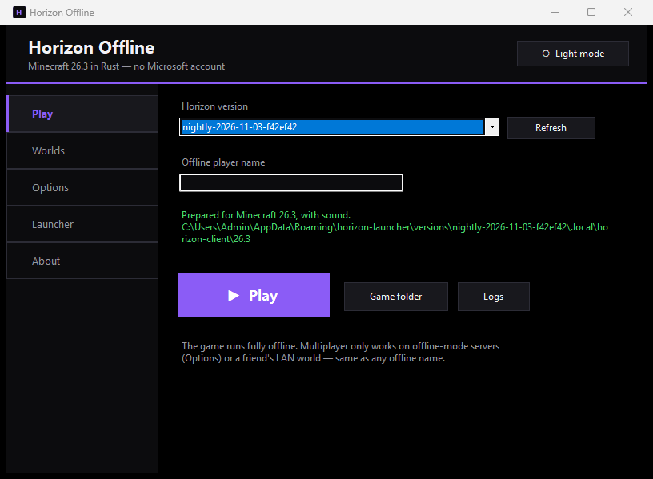
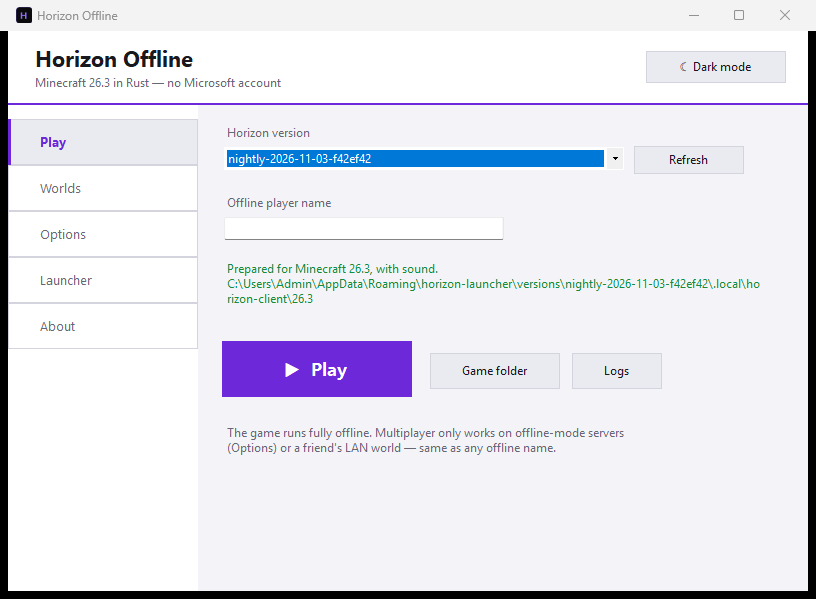

# Horizon Offline

**Play [Horizon](https://github.com/horizon-rust/horizon) — Minecraft: Java Edition 26.3 rewritten in [Rust](https://www.rust-lang.org/) — without a Microsoft account.**

[](#requirements)
[](LICENSE)
[](#what-this-is)

| AMOLED (default) | Light |
| --- | --- |
|  |  |

---

## What this is

Horizon is a from-scratch reimplementation of Minecraft 26.3 — the actual game, in Rust, not a
wrapper. Its [official launcher](https://playhorizon.dev) installs the game and *prepares* its
assets (textures, sounds, data) from **your own copy of Minecraft 26.3**, then starts it.

That launcher's **Play button** refuses to start the game unless a signed-in Microsoft account
owns Java Edition — an "owner gate" it added after the fact. **The game itself does not care**:
started without a session file it runs fully offline under any player name, exactly like vanilla
Minecraft does. Even Horizon's own docs list `horizon-client` and `horizon-ctl launch` as
unaffected by the gate — the check lives only in the launcher's Play path.

This project is a small, clean way around that one check:

1. It uses the launcher's **ungated** `prepare` command (the same one the launcher runs for
   everyone) to import game files from a Minecraft 26.3 copy on your PC — or downloads those
   files from Mojang's public file server.
2. `HorizonOffline.exe` then starts `horizon-client.exe` with **exactly the command the official
   launcher builds** (`--resources …` plus your options), minus the account check.

No Mojang code or assets are stored in this repository. No Microsoft account is used, asked for,
or needed anywhere in this tool.

## Features

- **One-file installer** that takes you from nothing to playing: finds (or downloads) Minecraft
  26.3 files, grabs the official Horizon launcher from GitHub, installs a game version, caches the
  server jar, runs `prepare`, and writes shortcuts.
- **Professional player GUI** — sidebar navigation, **AMOLED (true black) / Light theme toggle**,
  version picker, offline name, world resume/new-world with seed & gamemode, render distance,
  fullscreen, custom resolution, offline-server join, raw extra arguments.
- **Zero dependencies.** Everything here builds with the C# compiler already inside Windows
  (`csc.exe`) — no SDK, no NuGet, no Rust toolchain needed to build *this* wrapper (the game it
  launches, of course, is the Rust one).
- Works with Minecraft 26.3 files from **any launcher's** folder: official launcher, FastClient,
  Prism, MultiMC, ATLauncher, Modrinth App, CurseForge, GDLauncher — or a manual download.
- Re-synced with the exact hashes Horizon pins (`research-lock.json`), including all republished
  26.3 asset indexes.

## Requirements

| | |
| --- | --- |
| OS | Windows 10 or 11, x64 |
| Runtime | .NET Framework 4.x — **already present** on every Windows 10/11 |
| Disk | ~2 GB (game files + prepared resources + Java for the one-time prepare) |
| GPU | Vulkan or DirectX 12 (AMD/Intel/NVIDIA drivers from the last ~10 years) |
| Minecraft 26.3 files | from any launcher on your PC, **or** let the installer download them (~700 MB) |
| Network | needed for: preparing (downloads Mojang's Java 25 + server jar), and updating the game |

## Install (recommended)

1. Download `HorizonOfflineSetup.exe` from the [Releases](../../releases) page.
2. Run it. Windows SmartScreen will say "Windows protected your PC" (the exe is not
   code-signed): click **More info → Run anyway**.
3. Follow the wizard:
   - **Minecraft files** — it scans for a vanilla 26.3 copy on your PC (hashes are verified) or
     downloads 26.3 from Mojang's public file server.
   - **Horizon launcher** — uses one you already have, or downloads the newest from GitHub.
   - **Options** — install folder (default `%LOCALAPPDATA%\HorizonOffline`), shortcuts.
   - It then installs a game version, caches the server jar, and runs the **prepare** step
     (this is the long part, 5–15 minutes — it decompiles/exporters data from the game files and
     copies ~380 MB of sounds).
4. Click **Play Horizon now**, or use the new desktop shortcut later.

The wizard can also run unattended: `HorizonOfflineSetup.exe /S` (writes `install.log` next to
the install). Rerunning it is safe — finished steps are skipped.

## Manual setup (no installer)

Prefer the terminal? These are exactly what the installer does:

```powershell
# 1. Point the Horizon launcher at your Minecraft 26.3 folder
#    (any launcher's .minecraft — FastClient's %APPDATA%\.fastclient works)
& horizon-launcher.exe settings minecraft-dir 'C:\Users\You\AppData\Roaming\.fastclient'

# 2. Cache the 26.3 server jar somewhere the launcher checks
#    (its own download is flaky on some networks; this is the same public file)
mkdir "$env:APPDATA\horizon-launcher\server-jars" -Force
curl.exe -L -o "$env:APPDATA\horizon-launcher\server-jars\26.3.jar" `
  "https://piston-data.mojang.com/v1/objects/33680f5f2ac32864d6d7cf5e56a705fdb3e05f4c/server.jar"
# sha1 must be 33680f5f2ac32864d6d7cf5e56a705fdb3e05f4c

# 3. Install a game version if you have none, then prepare it
& horizon-launcher.exe install latest            # skip if a version is already installed
& horizon-launcher.exe prepare --version nightly-2026-11-03-f42ef42 `
    --minecraft 'C:\Users\You\AppData\Roaming\.fastclient'
# "… is prepared." when done

# 4. Play, with the player from this repo
& HorizonOffline.exe            # pick version + name in the GUI
# or straight into a world:
& HorizonOffline.exe --play
```

The prepared resources end up in
`%APPDATA%\horizon-launcher\versions\<tag>\.local\horizon-client\26.3`.

## Build from source

Nothing to install:

```bat
git clone <this repo>
cd horizon-offline
build.cmd
```

Outputs `bin\HorizonOffline.exe` and `bin\HorizonOfflineSetup.exe` (single file, player embedded).
`build.cmd` just calls `build.ps1`, which uses the in-box `C:\Windows\Microsoft.NET\Framework64\v4.0.30319\csc.exe`
and regenerates the icon (`tools\make-icon.ps1`) if it is missing.

Project layout:

```
src/Common.cs           theme (AMOLED/light), paths, hashing, Minecraft folder finder, config
src/HorizonOffline.cs   the player (sidebar GUI, theme toggle, launch logic)
src/Setup.cs            the installer (wizard, engine, downloads; --check-net, /S silent)
tools/make-icon.ps1     generates assets/horizon-offline.ico
tools/screencap.ps1     captures the player in both themes (for docs)
build.ps1 / build.cmd   build everything
```

## Using the player

| Tab | What |
| --- | --- |
| **Play** | pick the Horizon version, set your offline player name, Play. Status line shows whether the version is prepared (and whether sounds are in). |
| **Worlds** | resume a world on start (`--quickPlaySingleplayer`), or create a new one with a name/seed and creative mode. |
| **Options** | render distance, fullscreen, custom window size, join an offline-mode server at start, raw extra arguments. |
| **Launcher** | where `horizon-launcher.exe` lives, update the game, run *prepare* for a version, point at your Minecraft 26.3 folder. |
| **About** | how it works, links. |

Flags:

- `HorizonOffline.exe --play` — skip the window, start the game immediately (desktop shortcut
  material).
- `HorizonOffline.exe --theme amoled|light` — force a theme for this run.

Settings live in `horizon-offline.ini` next to the exe (plain text; the GUI writes it on exit).

Anything the GUI does can be overridden with **extra arguments** — `horizon-client.exe` supports
`--world`, `--seed`, `--creative`, `--render-distance`, `--server host:port`, `--pregen`,
`--quickPlaySingleplayer`, `--width/--height`, `--fullscreen` and more (`horizon-client --help`).

## Updating

- GUI → **Launcher** tab → *Update game + launcher*. This runs `horizon-launcher update`.
- New Horizon versions normally **inherit the prepared files** of the version before them, so
  Play keeps working across updates. If a version ever shows **"(not prepared)"**, click
  *Prepare selected version* — it re-imports from your Minecraft folder; no account is involved.
- Keep your Minecraft 26.3 folder around (the installer remembers its path in the ini and in the
  launcher's settings). If you delete it, point at another copy and prepare again.

## Uninstalling

- Delete `%LOCALAPPDATA%\HorizonOffline` and the desktop/start-menu shortcuts.
- Optionally reclaim space: prepared resources live in `%APPDATA%\horizon-launcher\versions\*`
  (each version's `.local` folder). Worlds/options/logs live in `%APPDATA%\horizon` — **delete
  only if you don't want your saves.**
- Nothing is written to the registry.

## Troubleshooting & known issues

1. **"Windows protected your PC" (SmartScreen).** The exes aren't code-signed (no paid
   certificate). *More info → Run anyway.* Building from source gives the same binaries.
2. **Antivirus flags the installer or player.** Unusual for this tool, but it downloads
   executables and writes files, and it's unsigned — some engines score that. Add the install
   folder as an exclusion. If your AV quarantines a *game* file instead, that's Horizon's binary.
3. **The launcher's own server-jar download times out** (`os error 10060` — seen in the wild).
   This installer pre-seeds the exact file at
   `%APPDATA%\horizon-launcher\server-jars\26.3.jar` (see the Manual setup section for the
   URL + sha1). If *prepare* still fails on it, run the two `curl` lines from above and prepare again.
4. **Prepare is slow / looks stuck.** It downloads Mojang's Java 25 (~180 MB) the first time,
   imports your game files, runs export tools and copies ~380 MB of sounds. 5–15 minutes is
   normal; the installer window shows the live log and percentage.
5. **"(not prepared)" after an update.** Auto-inheritance failed (e.g. disk full). Click
   *Prepare selected version*. If the version is very old and its exporters changed, the launcher
   downloads the server jar itself — the seed file above covers that.
6. **GitHub rate-limit when downloading the launcher** (`API rate limit`). Unauthenticated API
   calls are limited per IP; wait an hour, or download
   [`horizon-launcher-windows-x64.zip`](https://github.com/horizon-rust/horizon/releases) manually
   and pick it with **Browse…** in the wizard.
7. **Mojang's CDN blocked or very slow** (some ISPs/DNS filters). Choose the *local Minecraft
   folder* option instead — the hash-verified files from any launcher work (FastClient, Prism,
   the official launcher…).
8. **"This account doesn't own Minecraft"** — you'll never see this from this tool. You *will*
   see it if you press **Play** in the official Horizon launcher; that's its owner gate. Use
   `HorizonOffline.exe` instead.
9. **Online-mode servers kick you.** Offline names can't join servers that verify against Mojang
   (Hypixel etc.). Offline-mode servers, LAN worlds and hosting for friends work. This is a
   property of the offline name, identical for every offline launcher.
10. **The game needs Vulkan or DirectX 12.** Very old GPUs/VM graphics adapters will refuse to
    start the game window (Horizon's requirement, not this wrapper's). Update GPU drivers; in VMs,
    enable 3D acceleration.
11. **No sound.** The status line says "WITHOUT sound" when the sound copy failed during prepare
    (usually because the Minecraft folder was missing at that moment). Point the Launcher tab at a
    valid folder and run *Prepare* again.
12. **Disk space check fails mid-prepare.** Roughly 2 GB free is needed at the start (more if both
    Minecraft and the prepared copy live on the same drive as Windows).
13. **Windows username with non-ASCII characters.** Fine — all paths are handled as Unicode. The
    only place mojibake shows is if you read the ini in tools that assume legacy codepages;
    Notepad and the app itself are fine.
14. **Where are my worlds/logs?** `%APPDATA%\horizon` (`saves\`, `logs\latest.log`,
    `options.txt`) — shared with any other Horizon install, untouched by updates.
15. **"horizon-launcher.exe is not a valid Win32 application"** or similar when you picked a
    launcher manually — you probably picked a Linux/AppImage or macOS file from the releases
    page. Use the `-windows-x64.zip` asset.

## FAQ

- **Does this give me a Microsoft/Mojang account or unlock online play?** No. It only lets
  *Horizon's own client* start offline. Nothing is modified on Mojang's side, nothing is
  authenticated.
- **Is this piracy?** This repository ships no Minecraft code, assets or binaries. It wires
  together: your own Minecraft files (or Mojang's public downloads), the open-source Horizon
  launcher, and the open-source Horizon game. What you do with your files is your business.
- **Can I still use the official Horizon launcher?** Yes — this tool never modifies it. If you
  own Java Edition, you can sign in there and use its Play button like anyone else.
- **Why C#/WinForms and not Rust?** The thing that runs the game *is* the Rust project. This
  wrapper's whole point is a dependency-free, buildable-anywhere-on-Windows UI; the in-box
  compiler needs zero setup.
- **Mac/Linux?** The game runs there (see Horizon's releases), but this installer/player is
  Windows-only for now. On Linux/macOS the manual path works: prepare once with the launcher,
  then run `horizon-client --resources <path> --name <you>`.

## Legal

Not affiliated with, endorsed by, or connected to Mojang Studios, Microsoft, or the Horizon
project. "Minecraft" is a trademark of Mojang and Microsoft. Horizon is an unofficial fan project
([github.com/horizon-rust](https://github.com/horizon-rust/horizon), [playhorizon.dev](https://playhorizon.dev)).
This repository contains no Mojang code, assets or data. Its license (MIT) covers only the code
here.
## Credits

- **Horizon** — the game and launcher, by [Ludovic Marie](https://github.com/ludovic111) and
  contributors: [github.com/horizon-rust/horizon](https://github.com/horizon-rust/horizon).
[)]
